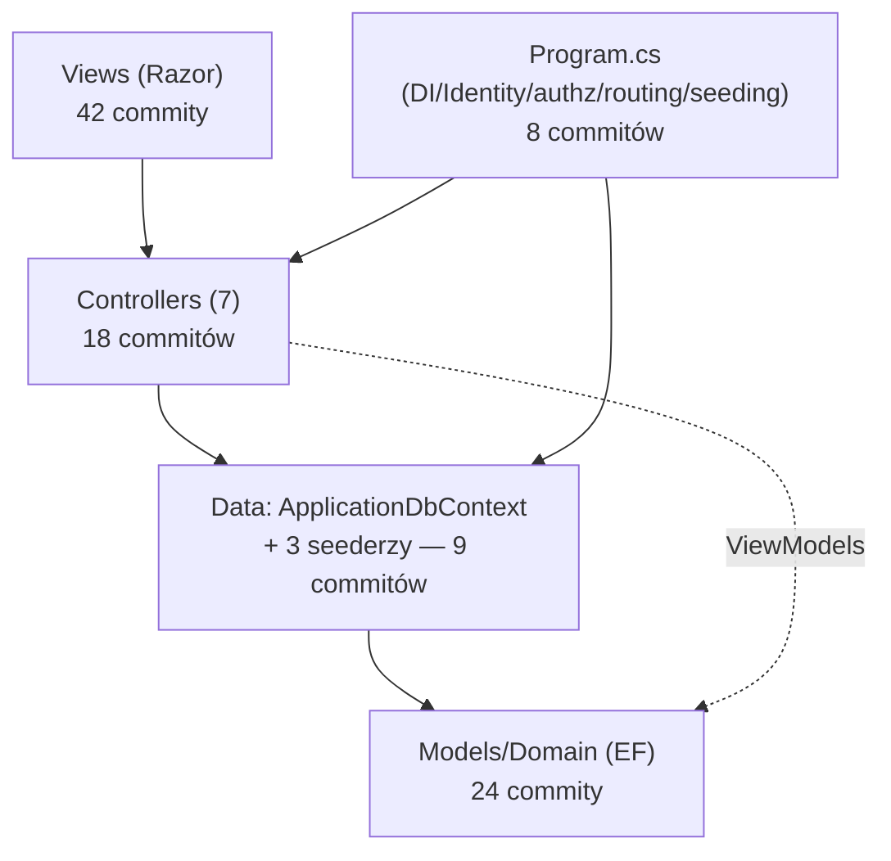

# Repo Map — MelodyBooker

> Synteza `artifact-1-territory.md` (historia gita), `artifact-2-structure.md` (graf referencji
> C#, zaadaptowany ręcznie — `dependency-cruiser` nie obsługuje C#) i `artifact-3-contributors.md`
> (kontrybutorzy). Pełne dane i metodyka w tych trzech plikach w `context/map/`.

## 1. TL;DR

MelodyBooker to mała aplikacja ASP.NET Core MVC (C#, net10.0) dla jednej szkoły muzycznej:
nauczyciele rezerwują sale na cotygodniowe lekcje, a system pilnuje, by sale ze sprzętem
specjalistycznym (pianino, ksylofon, perkusja) trafiały priorytetowo do uczniów grających na tych
instrumentach. Repo ma ~5-tygodniową historię (114 commitów, jeden autor) i żyje w czterech
warstwach: `Models/Domain` (fundament EF) → `Data` (`ApplicationDbContext` + seederzy) →
`Controllers` (7 sztuk, bez warstwy repozytorium) → `Views` (Razor). Praca skupia się dziś na
rosterze administratora (uczniowie/nauczyciele) i na hardeningu (testy, CI, logowanie) — widoku
nauczyciela i samego procesu rezerwacji dotyka się rzadziej, mimo że to rdzeń produktu. Najbardziej
boli: `Program.cs` jako "fałszywy hub" sześciu niepowiązanych odpowiedzialności, oraz reguła
konfliktu rezerwacji/niedopasowania instrumentu zduplikowana (przez wspólną funkcję statyczną) w
dwóch kontrolerach bez nic, co wymusiłoby ich synchronizację.

## 2. Teren — gdzie żyje odpowiedzialność, a gdzie peryferia

**Głębokie moduły (duża odpowiedzialność, mały interfejs):**
- `Models/Domain/Reservation.cs` — encja EF + dwie statyczne reguły biznesowe (`Overlaps`,
  `IsInstrumentMismatch`) implementujące FR-010/FR-011; mały plik, ale dźwiga logikę używaną przez
  dwa niezależne kontrolery.
- `Data/ApplicationDbContext.cs` — najwyższy fan-in w repo (10 plików go referencuje), jedyny
  prawdziwy "hub" struktury (brak warstwy repozytorium pośredniej).

**Płytkie/peryferyjne:**
- `src/melody/wwwroot` (64 commity w artifact-1, ale to **jeden** scaffoldowy commit z bibliotekami
  frontendowymi — zero realnej aktywności poza `site.css`).
- `.github/skills`, `.github/prompts` (112+8 commitów) — zsynchronizowany toolkit AI/notatki
  kursowe, nie kod produktu.
- `AdminController`, `HomeController` — trywialne, template'owe, zero logiki.

**Aktywność w czasie:** wzorzec wybuchowy, nie ciągły — dwa tygodnie budowy funkcji (W41: roster +
role-based auth; W43: rezerwacja sal + ostrzeżenie o instrumencie + polish UI rostera) przedzielone
cichymi tygodniami, a ostatnia fala (W45, wciąż trwająca) to już nie nowe funkcje tylko hardening:
testy brzegowe, migration-safety-gate, hooki jakości, E2E, i właśnie domknięty wątek logowania
połykanych wyjątków bazodanowych. Widok nauczyciela (`TeacherReservationsController`/`Teacher*`
Views) ma najmniej uwagi spośród warstw produktowych — rzadziej dotykany niż strona admina.

## 3. Realne powiązania

Z artifact-2 (graf referencji C#) i artifact-1 (co-change w gicie):

- **`context` ↔ `src`/`tests` (94%/81% commitów drugiej strony)** — to artefakt konwencji
  commitowania całej fazy planu naraz (`/10x-implement`), nie sprzężenie kodu. Prawdziwe
  sprzężenie kodu trzeba czytać z artifact-2, nie z tej pary.
- **`AdminReservationsController` ⇄ `TeacherReservationsController`** przez wspólną funkcję
  statyczną `Reservation.Overlaps`/`IsInstrumentMismatch` — realne sprzężenie logiki, wiedziane z
  grafu referencji (nie z historii gita): oba pliki wywołują dokładnie te same dwie metody, bez
  wspólnej klasy bazowej czy serwisu, który by to wymuszał.
- **`ApplicationDbContext` jako centralny hub** — 5 kontrolerów + 3 seederzy + `Program.cs`
  zależą od niego bezpośrednio (z grafu referencji). Nie ma warstwy repozytorium.
- **Cykl nawigacyjny `Teacher ⇄ Student ⇄ Reservation ⇄ Room`** (z grafu referencji) —
  standardowe dwukierunkowe właściwości EF Core wymagane przez `HasOne().WithMany()`, nie cykl
  logiki/importów. Oznaczone w artifact-2 jako "wygląda groźnie, ale nie jest".
- **`roadmap.md` jako "wspólny mianownik"** (z historii gita, 15 commitów, koreluje z niemal
  każdym obszarem) — to ręczny ledger procesu (`/10x-roadmap`/`/10x-archive`), nie generowany plik
  i nie sprzężenie kodu.
- **Brak grafu zależności dla `Views/*.cshtml`** — Razor nie ma statycznego importu w stylu JS;
  warstwa widoków była oceniana jakościowo (wzorcowo: nie duplikuje logiki biznesowej), nie przez
  graf. To `unknown` w sensie narzędziowym, nie "brak powiązań".

## 4. Strefy ryzyka

Każda strefa poparta ≥2 niezależnymi sygnałami (historia gita + struktura kodu, albo historia +
dokumentacja procesu).

| # | Strefa (język produktu) | Gdzie żyje w kodzie | Dlaczego |
|---|---|---|---|
| 1 | **Reguła podwójnej rezerwacji / niedopasowania instrumentu** | `Models/Domain/Reservation.cs` (`Overlaps`, `IsInstrumentMismatch`), wywoływane z `Controllers/AdminReservationsController.cs` i `Controllers/TeacherReservationsController.cs` | Sygnał 1 (struktura): dwa niezależne miejsca wywołania tej samej logiki, zero wymuszenia synchronizacji. Sygnał 2 (historia): oba pliki są w top-6 najczęściej zmienianych plików produktu — zmiana reguły ma wysoką szansę trafić tylko do jednego z dwóch miejsc |
| 2 | **Konfiguracja hostingu/autoryzacji** | `Program.cs` | Sygnał 1 (struktura): 6 niepowiązanych odpowiedzialności w jednym pliku (DI, Identity, cookies, authz fallback, telemetry, routing+seeding). Sygnał 2 (historia): 8 commitów, w tym 2 z 6 fix-ów całego repo dotyczyły właśnie auth w tym pliku |
| 3 | **Stabilność hooków jakości w CI** | `tests/melody.Tests/AgentHooksTests.cs`, `.github/hooks/*.js` | Sygnał 1 (historia): 3 fix-y na tym samym teście — jedyny realnie "ciągle psujący się" obszar repo. Sygnał 2 (na żywo w tej sesji): test zielony lokalnie, czerwony w CI (`dotnet` nieobecny w PATH w pewnym środowisku) — potwierdzony, nienaprawiony do końca na dzień pisania tej mapy |
| 4 | **Zapis danych bez warstwy pośredniej** | `Data/ApplicationDbContext.cs` + 5 kontrolerów, które go bezpośrednio wstrzykują | Sygnał 1 (struktura): najwyższy fan-in w repo (10 plików). Sygnał 2 (historia): każda zmiana schematu (migracje) lub reguły zapisu przechodzi przez ten sam plik — potwierdzone też przez niedawny wątek `log-swallowed-db-exceptions`, gdzie 3 niezależne `catch (DbUpdateException)` trzeba było poprawiać osobno w 3 kontrolerach |

Nie dobito do 6 na siłę — pozostałe kandydaci (np. `Views/AdminStudents`) mieli tylko jeden sygnał
(wysoka częstość zmian), bez drugiego niezależnego potwierdzenia ryzyka strukturalnego.

### Wygląda groźnie, ale nie jest

- `src/melody/wwwroot` — jeden scaffoldowy commit z bibliotekami wendora, nie obszar aktywności.
- Cykl `Teacher ⇄ Student ⇄ Reservation ⇄ Room` — standardowy wzorzec nawigacji EF Core.
- `.github/skills`, `.github/prompts` — zsynchronizowany toolkit/notatki, nie kod produktu mimo
  112+8 commitów.
- `context/foundation/roadmap.md` jako "wszystko koreluje z tym plikiem" — to ręczny ledger
  procesu, nie sprzężenie architektoniczne.

## 5. Kogo zapytać

Repo ma **jednego kontrybutora przez całą historię** (`lukaszzyglowicz`) — nie ma drugiej osoby do
wskazania. Przy zespole jednoosobowym to norma, nie ryzyko; zamiast "kogo zapytać", poniżej gdzie
szukać uzasadnienia decyzji, zanim zapyta się autora wprost:

| Strefa | Gdzie szukać kontekstu |
|---|---|
| 1. Reguła rezerwacji/instrumentu | `context/foundation/prd.md` (FR-008/010/011/012), `context/archive/2026-10-19-teacher-books-room/plan.md`, `context/archive/2026-10-20-specialist-instrument-warning/plan.md` |
| 2. `Program.cs` | `context/archive/2026-10-07-role-based-authorization/plan.md`, `context/changes/testing-deployment-migration-safety-gate/plan.md` |
| 3. Hooki CI | `context/changes/log-swallowed-db-exceptions/plan.md` (najświeższy wątek), `.github/hooks/check-edited-file.js` i `end-of-turn.js` (komentarze w kodzie) |
| 4. Warstwa danych | `context/archive/2026-10-09-admin-roster-management/plan.md`, `context/changes/log-swallowed-db-exceptions/plan.md` |

## 6. Pierwszy dzień — od czego zacząć

1. `context/foundation/prd.md` — wymagania funkcjonalne (FR-001..FR-016), role, reguły biznesowe.
2. `src/melody/Program.cs` — jak spięte jest DI/auth/routing/seeding (strefa ryzyka #2).
3. `src/melody/Data/ApplicationDbContext.cs` — centralny hub danych, relacje między encjami.
4. `src/melody/Models/Domain/Reservation.cs` — reguła FR-010/FR-011 w jednym miejscu (zanim
   zobaczysz, że jest wywoływana z dwóch kontrolerów).
5. `src/melody/Controllers/AdminReservationsController.cs` i
   `TeacherReservationsController.cs` — strefa ryzyka #1, czytać razem, nie osobno.
6. `tests/melody.Tests/MelodyWebApplicationFactory.cs` — jak repo testuje kontrolery bez warstwy
   repozytorium (SQLite in-memory + `WebApplicationFactory`).
7. `context/foundation/roadmap.md` — co jest zrobione, co zablokowane (np. issue #2: deploy/CI).
8. `.github/hooks/check-edited-file.js` i `end-of-turn.js` — jak wygląda pętla jakości tego repo
   (strefa ryzyka #3), zanim coś się edytuje.

(Wszystkie ścieżki zweryfikowane jako istniejące w repo w momencie pisania tej mapy.)

## 7. Ograniczenia

- **Okno czasowe**: cała historia repo to tylko ~5 tygodni (2026-10-02 → 2026-11-09, 114
  commitów) — za krótko, by ekstrapolować długoterminowe trendy; wzorzec "wybuchowy" może się nie
  powtórzyć.
- **Metoda**: brak narzędzia class-dependency dla C# (`dependency-cruiser` obsługuje tylko
  JS/TS) — graf struktury zbudowany ręcznie przez grep/odczyt kodu na 35 plikach `.cs`; przy
  znacznie większym repo ta metoda przestałaby się skalować.
- **Kontrybutorzy**: jeden autor przez całą historię — mapa "kogo zapytać" nie mówi nic o ryzyku
  bus-factor poza oczywistym, bo nie ma danych o drugiej osobie.
- **Udział AI**: nie da się wiarygodnie policzyć, bo trailer `Co-authored-by: Copilot` pojawia się
  dopiero w części historii (5/114 commitów go niesie, mimo że większość pracy produktowej
  powstała przez skille `/10x-*`).
- **Views (`*.cshtml`)**: nieoznaczone grafem zależności (Razor nie ma statycznego importu) —
  oceniane jakościowo, nie ilościowo; to `unknown`, nie "brak powiązań".
- Ta mapa to zdjęcie struktury i aktywności w oknie ~5 tygodni — nie mówi nic o tym, co się stanie
  przy wejściu drugiego kontrybutora, ani o jakości samego kodu poza tym, co widać z grafu
  referencji i historii commitów.
